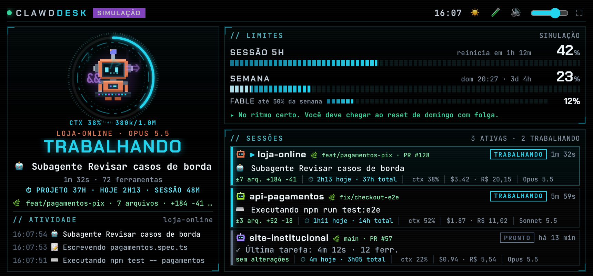
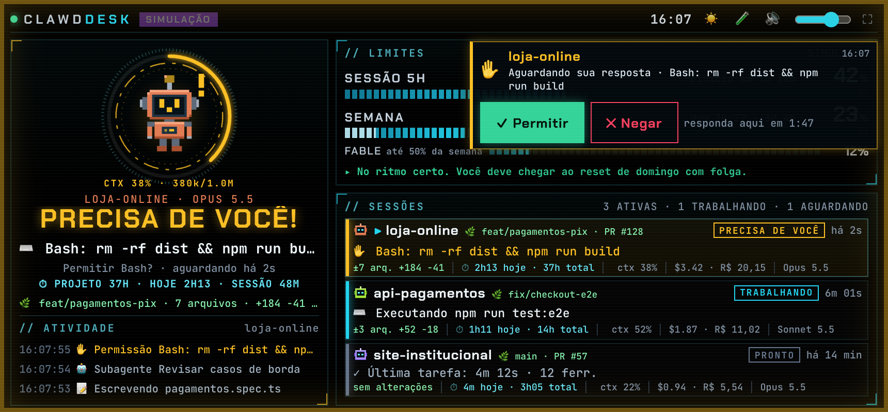
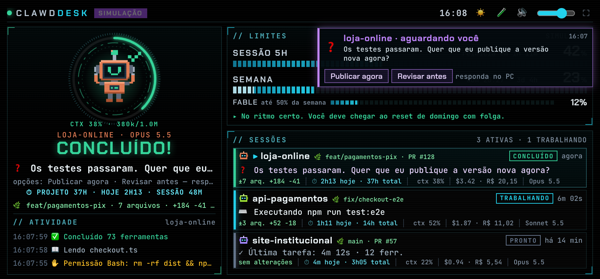
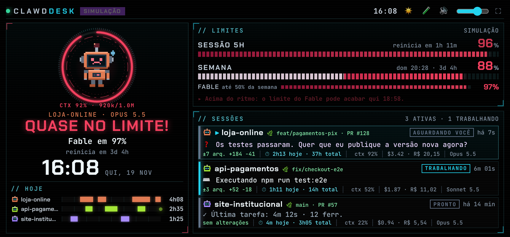
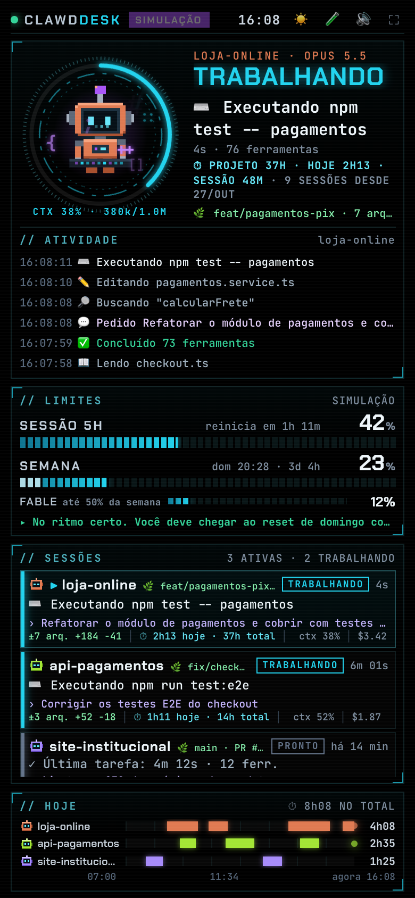
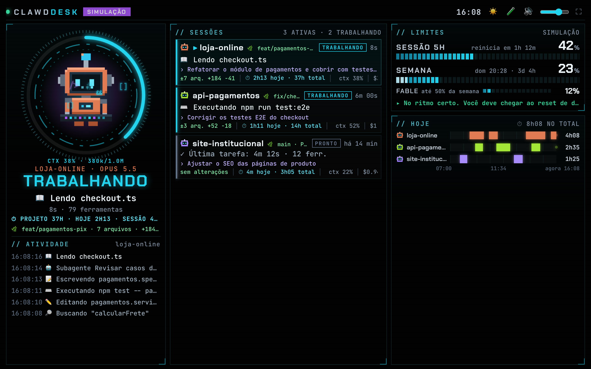
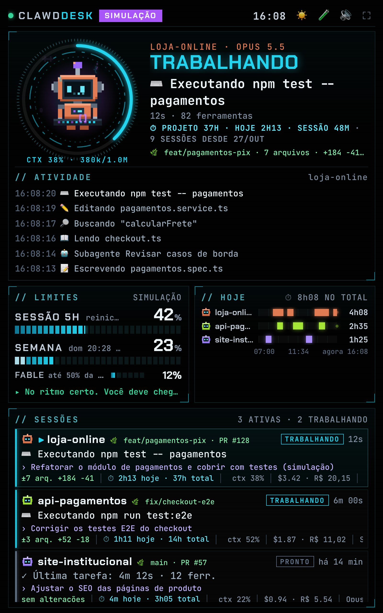
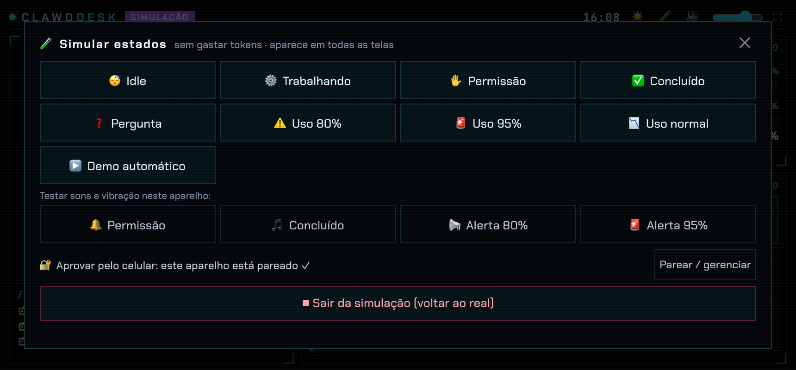
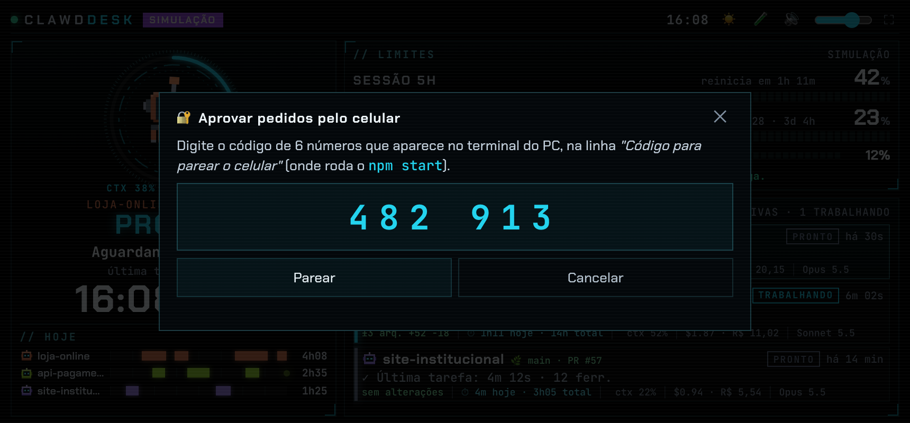

# 🤖 ClawdDesk

**Transforme um celular (ou tablet) antigo em um monitor de mesa sempre ligado para o
[Claude Code](https://docs.claude.com/en/docs/claude-code).** Veja em tempo real o que cada sessão
está fazendo, seus limites de uso, quanto tempo o Claude trabalhou em cada projeto, e **aprove ou
negue pedidos de permissão direto pelo celular** — tudo pela sua rede Wi-Fi, sem nuvem.



> Projeto independente e não oficial, sem vínculo com a Anthropic. "Claude" e "Claude Code" são
> marcas da Anthropic. Imagens deste README geradas com o modo de simulação (dados fictícios).

---

## Sumário

- [Recursos](#recursos)
- [Como funciona](#como-funciona)
- [Requisitos](#requisitos)
- [Instalação](#instalação)
- [Conectar o celular](#conectar-o-celular)
- [Aprovar pedidos pelo celular](#aprovar-pedidos-pelo-celular)
- [Comandos](#comandos)
- [De onde vêm os números](#de-onde-vêm-os-números)
- [Configuração](#configuração)
- [Segurança e privacidade](#segurança-e-privacidade)
- [Desinstalar](#desinstalar)
- [Problemas comuns](#problemas-comuns)
- [Estrutura do projeto](#estrutura-do-projeto)

---

## Recursos

### Estado de cada sessão, em tempo real
Um robô pixel-art dentro de um anel luminoso mostra o estado da sessão mais urgente — **pronto**,
**trabalhando** (com a ferramenta e o arquivo atuais), **precisa de você** ou **concluído** — e um
histórico dos últimos passos. O anel mostra o uso de contexto. Cada projeto tem sua **cor fixa**:
o robô veste a cor do projeto em destaque.

### Todas as sessões abertas
Um cartão por sessão do Claude Code: projeto, estado, ferramenta atual, **git** (branch, PR,
arquivos e linhas alteradas), **tempo trabalhado** hoje e no total do projeto, contexto, custo
equivalente em **dólar e em reais** e modelo.

### Limites de uso da sua conta
Janela de 5 horas, limite **semanal**, limites **por modelo** (ex.: Fable "até 50% da semana") e uma
mensagem de **ritmo**: se você vai chegar ao reset com folga ou se algum limite pode acabar antes.

### ✋ Aprovar ou negar pelo celular
Quando o Claude pede permissão (rodar um comando, editar um arquivo…), o aviso aparece com
**Permitir** e **Negar**. O pedido continua aparecendo no PC ao mesmo tempo — vale a primeira resposta.



### ❓ Perguntas esperando você
Quando uma resposta termina com uma pergunta, ela aparece no celular com as opções, para você saber
o que o Claude está esperando.



### 🚨 Alertas de limite
Barras ficam âmbar a partir de 60% e vermelhas pulsantes a partir de 80%; o robô "sua" e um tom de
aviso toca em 80% e em 95%. Com tudo parado, o celular mostra a **linha do tempo do dia**: quando o
Claude trabalhou em cada projeto.



### Celular na vertical e tablet
O layout se reorganiza ao girar a tela. Em tablets (ou no navegador do PC) a tela ganha colunas.

| Celular na vertical | Tablet na horizontal |
|---|---|
|  |  |

<details>
<summary>Tablet na vertical</summary>


</details>

### E mais
- 🔔 Avisos com som (sintetizado, sem arquivos de áudio) e vibração para **todas** as sessões:
  concluiu, aguardando resposta, erro.
- ☀️ Tela sempre ligada (Wake Lock + fallback para HTTP), proteção anti burn-in para OLED.
- 🔄 Atualização automática: ao atualizar o ClawdDesk, o celular recarrega sozinho.
- 🧪 Modo **simulação** para testar todas as telas, sons e alertas sem gastar tokens.



---

## Como funciona

```
 Claude Code (terminal ou app)                 PC                           Celular / tablet
 ─────────────────────────────    ┌──────────────────────────────┐    ┌────────────────────────┐
  hooks (eventos)  ──────────────▶│  ClawdDesk (Node.js, :3456)  │    │  página web (PWA)      │
  statusLine (contexto, limites) ▶│  · estado das sessões        │◀══▶│  WebSocket em tempo    │
  logs ~/.claude/projects ───────▶│  · limites, tempo, git, custo│    │  real pela rede Wi-Fi  │
  API de uso do Claude.ai ───────▶│  · aprovações pelo celular   │    └────────────────────────┘
                                  └──────────────────────────────┘
```

1. O `npm run setup-hooks` registra **hooks** no `~/.claude/settings.json`. A cada evento (pedido,
   ferramenta, permissão, conclusão…) o Claude Code chama um script do ClawdDesk, que avisa o servidor.
2. O servidor junta isso com os **logs locais** do Claude Code, o **git** de cada pasta e os
   **limites da conta**, e transmite tudo por **WebSocket** para a página aberta no celular.
3. A página é um PWA em HTML/CSS/JS puro, servido pelo próprio servidor — nada é instalado no celular
   além do navegador.

---

## Requisitos

- **Node.js 18.17+** no PC onde o Claude Code roda (testado no **macOS**; Linux deve funcionar; no
  Windows os hooks são instalados no formato adequado, mas o `npm run restart` não está disponível).
- **Claude Code** 2.x (os hooks `PermissionRequest` e o `rate_limits` do statusLine vêm das versões
  recentes). Funciona com o Claude Code no terminal e no app desktop do Claude.
- Um **celular ou tablet** com navegador moderno (testado com Chrome no Android) na **mesma rede Wi-Fi**.
- Para os limites oficiais de 5h/semana: login no Claude Code com uma conta **Pro, Max** (ou plano
  com limites). Contas por API key mostram custo e tokens, mas não esses limites.

---

## Instalação

```bash
git clone https://github.com/flavio-r/clawd-desk.git
```

```bash
cd clawd-desk
```

```bash
npm install
```

```bash
npm run setup-hooks
```

```bash
npm start
```

Depois do `setup-hooks`, **reinicie as sessões abertas do Claude Code** para elas carregarem os hooks.

O `npm start` mostra no terminal:

```
  🤖 ClawdDesk — monitor de mesa para o Claude Code

  No PC:       http://localhost:3456
  No celular:  http://192.168.0.10:3456  (en0)
  [QR Code]
  ✅ Hooks do Claude Code instalados em ~/.claude/settings.json
  🔐 Código para parear o celular (aprovar pedidos por ele): 482 913
```

### O que o `setup-hooks` faz no seu `settings.json`

- Faz **backup** antes (`settings.json.clawddesk-backup-AAAAMMDD-HHMMSS`) e aborta se o JSON for inválido.
- Adiciona só as entradas do ClawdDesk; seus outros hooks continuam intactos; rodar de novo não duplica.
- Os hooks de eventos são **assíncronos** (não deixam o Claude mais lento). O de `PermissionRequest`
  espera a resposta do celular pareado — e, se não houver celular pareado e conectado, sai na hora.
- Se você já tinha um `statusLine`, ele é **preservado e encadeado** (continua aparecendo no terminal).
- `npm run remove-hooks` desfaz tudo e restaura o seu `statusLine` original.

---

## Conectar o celular

1. No celular (mesmo Wi-Fi), abra o endereço mostrado pelo `npm start` ou escaneie o **QR Code**.
   Na primeira vez, o macOS pode pedir para o `node` aceitar conexões de entrada — clique em **Permitir**.
2. Toque em **"Toque para ativar modo mesa"**: liga a tela sempre acesa, libera os sons e entra em
   tela cheia.
3. Deixe o celular de pé na mesa, na horizontal ou na vertical.

**Para um aparelho dedicado**, vale também ligar *Opções do desenvolvedor → Permanecer ativo* (a tela
não apaga enquanto carrega) e tirar o Chrome da otimização de bateria.

**Instalar como app (opcional):** o Chrome só oferece "Instalar app" em HTTPS ou `localhost`. Pelo
Wi-Fi, abra `chrome://flags/#unsafely-treat-insecure-origin-as-secure`, adicione `http://SEU-IP:3456`,
reinicie o Chrome e use ⋮ → *Instalar app*. Pelo cabo USB: `adb reverse tcp:3456 tcp:3456` e abra
`http://localhost:3456`.

**TV ou monitor sem toque:** abra `http://SEU-IP:3456/?kiosk` — pula a tela de ativação e já mantém
a tela ligada (o som precisa de um clique/toque).

---

## Aprovar pedidos pelo celular

1. **Pareie o celular (uma vez):** toque em 🧪 → *Parear / gerenciar* e digite o código de 6 números
   que aparece no terminal do `npm start` (ou na página aberta no próprio PC).

   

2. Pronto: os próximos pedidos chegam com **Permitir** / **Negar** e uma contagem regressiva.

Detalhes:
- O pedido continua aparecendo no PC: vale a primeira resposta. Se ninguém responder no celular em
  ~110 s, ele fica só no PC.
- Só aparelhos pareados conseguem responder (o token fica guardado só como hash em `data/paired.json`).
- **Perguntas com opções** são mostradas no celular, mas respondidas no PC.
- No **auto mode** do Claude Code quase nada pede permissão (o próprio Claude aprova); quando pede, a
  aprovação pelo celular funciona. Em alguns casos especiais o Claude Code recusa aprovações vindas de
  hooks — aí basta responder no PC.
- Desparear: 🧪 → *Parear / gerenciar* → *Desparear este aparelho*. Para revogar todos, apague
  `data/paired.json` e rode `npm run restart`.

---

## Comandos

| Comando | O que faz |
|---|---|
| `npm start` | Sobe o servidor em `0.0.0.0:3456`, mostra IP, QR Code e código de pareamento |
| `npm run restart` | Encerra o ClawdDesk que estiver rodando (só ele) e sobe a versão atual |
| `npm run setup-hooks` | Instala/atualiza hooks e statusLine no `~/.claude/settings.json` (com backup) |
| `npm run remove-hooks` | Remove tudo e restaura seu statusLine original |
| `npm run demo` | Demonstração automática de todos os estados (`npm run demo -- permission` para um só) |
| `npm run icons` | Regera os ícones do PWA a partir da arte do robô |

Opções do `setup-hooks`: `--dry-run`, `--minimal` (só os 5 eventos básicos), `--no-statusline`,
`--port N`, `--settings <arquivo>`.

### Eventos → estados

| Evento do Claude Code | Na tela |
|---|---|
| `UserPromptSubmit` | Trabalhando (pensando) |
| `PreToolUse` / `PostToolUse` | Trabalhando — ferramenta e arquivo (✏️ Editando app.ts, ⌨️ npm test…) |
| `PermissionRequest` / `Notification` | Precisa de você — aviso âmbar, bipe, vibração, Permitir/Negar |
| `AskUserQuestion` / pergunta no fim da resposta | Aguardando você — a pergunta e as opções |
| `Stop` | Concluído (volta para "pronto" após 12 s) |
| `StopFailure` | Parou com erro |
| `SessionStart` / `SessionEnd` | Sessão aparece / some |

---

## De onde vêm os números

| Informação | Fonte |
|---|---|
| **Limites 5h e semanal** | 1) `rate_limits` do **statusLine** (Claude Code no terminal) · 2) **API de uso do Claude.ai** (`/api/oauth/usage`, a mesma do `/usage`), com o token OAuth do Claude Code · 3) **estimativa** pelos logs locais, calibrada com a última leitura oficial |
| **Limites por modelo e ritmo** | API de uso (`limits`, `weekly_scoped_shares`); o ritmo é uma projeção do % usado em relação ao tempo da semana |
| **Contexto** | statusLine, ou a última resposta no transcript da sessão |
| **Tempo trabalhado** | Logs `~/.claude/projects`: soma de cada turno, do pedido até a última resposta (o tempo esperando você não conta; cada turno conta no máximo 4 h) |
| **Git** | `git status` e `git diff` na pasta da sessão (só leitura); PR pelo registro `pr-link` dos logs |
| **Custo** | Tokens dos logs × preço público da API — é um **custo equivalente** (no Pro/Max você não paga por token). Em reais pela cotação do dia (AwesomeAPI; reserva open.er-api.com) |

**Sobre o token OAuth:** é lido do Keychain do macOS (`Claude Code-credentials`) ou de
`~/.claude/.credentials.json`, usado **só** para consultar `api.anthropic.com` e **nunca** enviado ao
celular nem renovado pelo ClawdDesk. Se ele vencer (o Claude Code renova ao ser aberto no terminal),
as barras seguem por estimativa. O endpoint de uso não é documentado oficialmente e pode mudar.
Para desligar essa consulta: `CLAWDDESK_OAUTH=0 npm start`.

---

## Configuração

Variáveis de ambiente (ex.: `CLAWDDESK_PORT=3457 npm start`):

| Variável | Padrão | Uso |
|---|---|---|
| `CLAWDDESK_PORT` | `3456` | Porta do servidor (rode também `npm run setup-hooks -- --port N`) |
| `CLAWDDESK_OAUTH` | `1` | `0` desliga a consulta à API de uso do Claude.ai |
| `CLAWDDESK_OAUTH_POLL_S` | `120` | Intervalo da consulta de uso (mín. 60 s) |
| `CLAWDDESK_USD_BRL` | cotação do dia | Fixa a cotação do dólar usada para mostrar custos em reais |
| `CLAWDDESK_EST_5H_USD` / `CLAWDDESK_EST_7D_USD` | — | Limites (em USD equivalentes) para a estimativa, em vez da calibração automática |
| `CLAWDDESK_CONTEXT_WINDOW` | auto | Força o tamanho da janela de contexto (tokens) |
| `CLAWDDESK_APPROVAL_WAIT_S` | `110` | Quanto tempo o celular pareado pode responder um pedido de permissão |
| `CLAWDDESK_APPROVAL_WAIT_DESKTOP_S` | `110` | O mesmo, para sessões do app desktop (`0` desliga) |
| `CLAWDDESK_QUIET` | `0` | `1` silencia o log do terminal |
| `CLAUDE_CONFIG_DIR` | `~/.claude` | Pasta de configuração do Claude Code |

---

## Segurança e privacidade

- Nenhum dado sai do seu computador, exceto: a consulta opcional de uso em `api.anthropic.com` e a
  cotação do dólar (que só pede "USD-BRL").
- `POST /api/event`, `/api/statusline` e `/api/permission/request` só aceitam chamadas do próprio PC.
- Responder pedidos de permissão exige pareamento (código de 6 dígitos, limite de tentativas).
- O painel em `:3456` é visível para quem estiver na mesma rede e mostra nomes de projetos, pedidos e
  arquivos. **Use em uma rede confiável.**
- Os dados locais (pareamento, cores, calibração, cotação) ficam em `data/`, fora do git.

---

## Desinstalar

```bash
npm run remove-hooks
```

Depois, apague a pasta do projeto. Seu `settings.json` volta ao que era (com backup ao lado).

---

## Problemas comuns

- **O celular não abre a página:** confirme o mesmo Wi-Fi, use o IP mostrado pelo `npm start` e libere
  o `node` no firewall do macOS (Ajustes → Rede → Firewall).
- **A tela não reage ao Claude:** rodou `npm run setup-hooks` e reiniciou o Claude Code? Sem hooks, a
  tela mostra "no PC: npm run setup-hooks".
- **Barras 5h/Semana com "—":** ainda não chegou leitura oficial. Use o Claude Code no terminal ou faça
  `/login` nele com uma conta de assinatura.
- **"A porta 3456 já está em uso":** já há um ClawdDesk rodando — use `npm run restart`.
- **A tela apagou:** toque no 🌙 da barra superior e ligue "Permanecer ativo" nas opções do desenvolvedor.
- **Pedidos demorando a aparecer no app desktop com o celular pareado:** rode com
  `CLAWDDESK_APPROVAL_WAIT_DESKTOP_S=0`.

---

## Estrutura do projeto

```
server/    index.js (HTTP + WebSocket + QR) · state.js (sessões) · usage.js (limites, logs, tempo)
           approvals.js (aprovar pelo celular) · git.js · colors.js · fx.js (cotação) · simulator.js
hooks/     clawddesk-hook.js (eventos) · clawddesk-permission.js (aprovações) · clawddesk-statusline.js
scripts/   setup-hooks.js · restart.js · demo.js · gen-icons.js
public/    index.html · manifest.json · sw.js · css/ · js/ · fonts/ · icons/
docs/      screenshots/
data/      gerado em execução (fora do git)
```

---

## Licença

[MIT](LICENSE). As fontes em `public/fonts/` (Chakra Petch e JetBrains Mono) são distribuídas sob a
SIL Open Font License 1.1.
